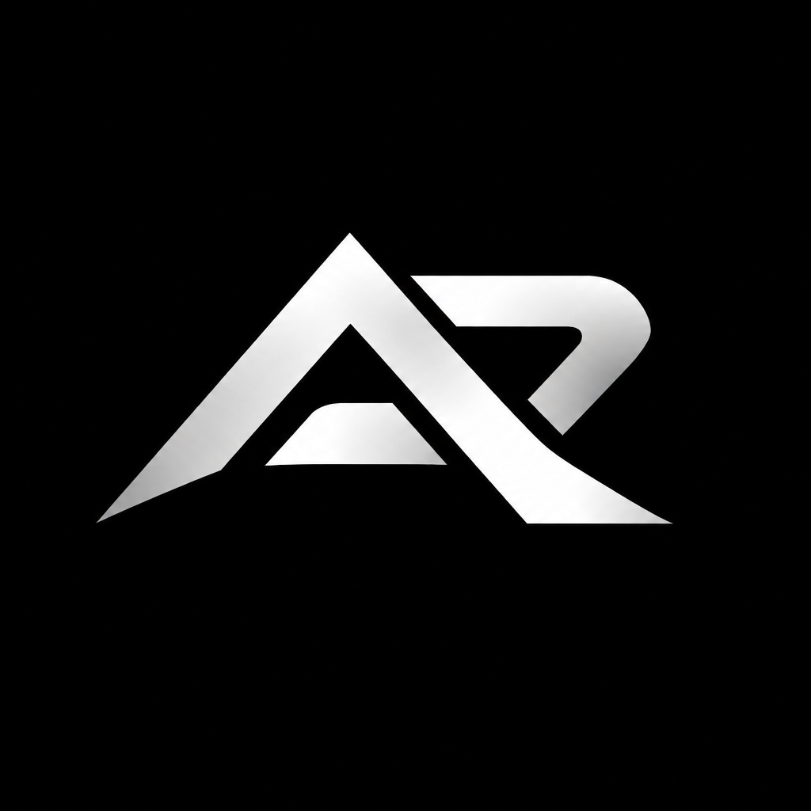

<!-- Animated, Badge, Visuals (SEO Optimized Keywords) -->
<!--
=============================================================
  ARQYON PicShop -README.md
  Copyright (c) 2026 ARQYON. All Rights Reserved.
  Author: Adil Hassan | ARQYON.co
  SEO Keywords: image editor windows, photoshop alternative,
  free photo editing software, AI image editor, ARQYON,
  professional image editing tool, SVPicShop, Qt6 image editor,
  C++ image editor, open source photoshop windows
=============================================================
-->

<div align="center">

<!-- LOGO -->


<br/>
<br/>

<!-- TITLE -->
# ARQYON PicShop

### Professional Image Editing Software for Windows
*Built with C++ · Qt6 · Rust · Python*

<br/>

<!-- BADGES -->


<br/>

<!-- SHORT DESCRIPTION -SEO OPTIMIZED -->
**ARQYON PicShop** is a free, professional-grade image editing software for Windows.
Designed as a powerful alternative to Adobe Photoshop, PicShop gives you
full control over your creative workflow -layers, filters, brushes, text,
and AI-powered tools -all in one fast, lightweight desktop application.

<br/>

<!-- QUICK LINKS -->
[🌐 Website](https://ARQYON.co) &nbsp;·&nbsp;
[📥 Download](https://ARQYON.co/download) &nbsp;·&nbsp;
[📖 Documentation](https://ARQYON.co/docs) &nbsp;·&nbsp;
[🐛 Report Bug](https://ARQYON.co/support) &nbsp;·&nbsp;
[💬 Support](https://ARQYON.co/support) &nbsp;·&nbsp;
[🔒 Security](SECURITY.md)

<br/>

<!-- PREVIEW BANNER -Replace with actual screenshot -->


</div>

---

## 📋 Table of Contents

- [About](#about)
- [Features](#features)
- [Tech Stack](#tech-stack)
- [Installation](#installation)
- [Build from Source](#build-from-source)
- [Project Structure](#project-structure)
- [Roadmap](#roadmap)
- [License](#license)
- [Author](#author)

---

## 🖼️ About

**ARQYON PicShop** is a professional image editing desktop application
built for Windows, developed independently by **Adil Hassan** under his
software company **ARQYON**.

Inspired by industry-leading tools like Adobe Photoshop, ARQYON PicShop
aims to deliver a **fast, powerful, and accessible** image editing experience
-for free in V1, with optional AI-powered paid features in V2+.

### Why ARQYON PicShop?

| Feature | ARQYON PicShop | Adobe Photoshop |
|---------|------------------|-----------------|
| Price (V1) | ✅ Free | ❌ $20+/month |
| Windows Support | ✅ Yes | ✅ Yes |
| Layer System | ✅ Yes | ✅ Yes |
| AI Features (V2) | ✅ Affordable | ❌ Expensive |
| Lightweight | ✅ Yes | ❌ Heavy |
| Custom Project Format | ✅ `.svp` | ✅ `.psd` |
| Privacy (No cloud) | ✅ Local only | ❌ Cloud required |

---

## ✨ Features

### 🎨 Core Tools
- **Brush Tool** - adjustable size, hardness, and opacity
- **Eraser Tool** - clean and precise erasing
- **Crop Tool** - freehand and fixed-ratio cropping
- **Resize Tool** - resize with aspect ratio lock
- **Selection Tool** - rectangular and elliptical selections
- **Text Tool** - add text with custom fonts, sizes, and colors
- **Color Picker** - pick any color from the canvas
- **Fill Tool** - fill areas with selected color
- **Move Tool** - move layers and selections freely

### 🗂️ Layer System
- Create, delete, duplicate, and reorder layers
- Layer visibility toggle
- Layer opacity control (0–100%)
- Blend modes
- Merge and flatten layers
- Save and restore layers via `.svp` project format

### 🎛️ Filters & Adjustments
- Brightness / Contrast
- Hue / Saturation / Lightness
- Grayscale conversion
- Invert colors
- Gaussian Blur
- Sharpen
- Noise reduction

### 📁 File Support
- **Open:** PNG, JPG, JPEG, BMP, TIFF
- **Save:** PNG, JPG, JPEG
- **Project:** `.svp` (ARQYON Project - saves all layers)
- Recent files list (last 10 files)

### 🖥️ User Interface
- Dark theme (default) and Light theme
- Toolbar, Layers, Properties, and Color panels
- Full keyboard shortcut support
- Status bar with zoom level, canvas size, cursor position
- Smooth zoom (10% -3200%)

### 🤖 AI Features *(V2+ Paid)*
- One-click background removal
- AI-powered filters and style transfer
- Noise reduction using neural networks
- Smart object selection

---

## 🛠️ Tech Stack

| Layer | Technology | Purpose |
|-------|-----------|---------|
| 🖥️ GUI | Qt6 (C++) | All UI - windows, panels, canvas |
| ⚙️ Core Engine | C++17 | Image processing and rendering |
| 🦀 System Layer | Rust | Memory safety and plugin sandbox |
| 🐍 AI Layer | Python 3 | OpenCV, PyTorch, TensorFlow |
| 🔗 C++↔Rust | FFI | Cross-language bridge |
| 🔗 C++↔Python | pybind11 | AI integration bridge |
| 📦 Build System | CMake 3.25+ | Cross-module build management |
| 🪟 Installer | Inno Setup | Windows `.exe` installer |
| 🌐 Website | MERN Stack | ARQYON.co company website |

---

## 📥 Installation

### Download (Recommended)

1. Visit **[ARQYON.co/download](https://ARQYON.co/download)**
2. Download `SVPicShop_Setup_v1.0.0.exe`
3. Verify the SHA256 checksum (published on download page)
4. Run the installer and follow the steps
5. Launch **ARQYON PicShop** from desktop or Start Menu

> ✅ **V1 is completely free. No account or activation required.**

### System Requirements

| Component | Minimum | Recommended |
|-----------|---------|-------------|
| OS | Windows 10 64-bit | Windows 11 64-bit |
| RAM | 4 GB | 8 GB or more |
| Storage | 500 MB | 1 GB |
| GPU | Any DirectX 11 | Dedicated GPU |
| Display | 1280 × 720 | 1920 × 1080 |

---

## 🔨 Build from Source

> **Note:** Source code is private and available only to
> authorized contributors. See [CONTRIBUTING.md](CONTRIBUTING.md).

### Prerequisites

```bash
# Required tools
CMake 3.25+
Qt 6.5+ (with OpenGL, Widgets, Svg, Network, Xml)
GCC / MinGW-w64 (C++17 support)
Ninja build system
Rust (latest stable -via rustup)
Python 3.10+
```

### Build Steps

```bash
# 1. Clone repository (authorized users only)
git clone https://github.com/ARQYON/SVPicShop.git
cd SVPicShop

# 2. Configure Debug build
cmake --preset windows-debug

# 3. Build
cmake --build --preset build-debug

# 4. Run
./build/windows-debug/bin/SVPicShop.exe
```

### Build Release (Ship)

```bash
# Configure Release
cmake --preset windows-release

# Build optimized SVPicShop.exe
cmake --build --preset build-release

# Output location
./build/windows-release/bin/SVPicShop.exe
```

### Run Tests

```bash
# Run all tests
ctest --preset test-debug
```

### Run the C++ Engine Tests in VS Code

Install the recommended **C/C++** extension and MinGW-w64 with a C++17-capable
`g++.exe` and `gdb.exe`. Add MinGW-w64's `bin` directory to your Windows
`PATH`, then restart VS Code. Then:

- Press **Ctrl+Shift+B** to build the engine test executable.
- Select **Terminal > Run Task > Run PicShop engine tests** to build and run it.
- Press **F5** and choose **Debug PicShop engine tests** to debug the suite.

The engine headers in `core/` are included by the test program; they are not
standalone executables. This VS Code workflow builds the core test suite and
does not build the Qt GUI application.

---

## 📁 Project Structure

```
ARQYONPicShop/
│
├── 📄 CMakeLists.txt          # Master build system
├── 📄 CMakePresets.json       # Debug / Release presets
├── 📄 README.md               # This file
├── 📄 LICENSE                 # Proprietary license
├── 📄 CHANGELOG.md            # Version history
├── 📄 CONTRIBUTING.md         # Contribution guidelines
├── 📄 SECURITY.md             # Security policy
│
├── 📁 core/                   # C++17 image engine
│   ├── include/               # Public headers
│   └── src/                   # Source files
│
├── 📁 ui/                     # Qt6 GUI layer
│   ├── include/               # UI headers
│   ├── src/                   # UI source files
│   └── resources/             # .qrc resource files
│
├── 📁 rust/                   # Rust system layer
│   ├── src/                   # Rust source
│   └── Cargo.toml             # Rust package manifest
│
├── 📁 ai/                     # Python AI features
│   ├── models/                # AI model weights
│   ├── src/                   # Python source
│   └── tests/                 # Python tests
│
├── 📁 assets/                 # App assets
│   ├── images/                # Logo, screenshots
│   ├── icons/                 # App and tool icons
│   ├── fonts/                 # Bundled fonts
│   └── windows/               # Windows app.rc resource
│
├── 📁 docs/                   # Documentation
├── 📁 tests/                  # All tests
├── 📁 scripts/                # Build scripts
├── 📁 installer/              # Inno Setup config
└── 📁 website/                # MERN company website
```

---

## 🗺️ Roadmap

| Version | Status | Highlights |
|---------|--------|------------|
| **v0.1.0** | ✅ Done | Project initialized |
| **v0.5.0** | 🔄 Planned | Alpha - core engine + basic UI |
| **v0.9.0** | 🔄 Planned | Beta - full V1 feature set |
| **v1.0.0** | 🔄 Planned | 🎉 Free public release |
| **v1.1.0** | 🔄 Planned | PSD import/export |
| **v1.2.0** | 🔄 Planned | Plugin marketplace |
| **v2.0.0** | 🔄 Planned | 💰 Paid - AI features launch |
| **v2.1.0** | 🔄 Planned | Background removal (AI) |
| **v2.2.0** | 🔄 Planned | AI style transfer filters |
| **v3.0.0** | 🔄 Planned | Linux support |

---

## 📜 License

**ARQYON PicShop** is proprietary software.

```
Copyright (c) 2026 ARQYON -Adil Hassan
All Rights Reserved.

Unauthorized copying, distribution, modification,
or reverse engineering of this software is strictly
prohibited and will be prosecuted to the fullest
extent of the law.
```

See full license: [LICENSE](LICENSE)
For licensing inquiries: licensing@ARQYON.co

---

## 👨‍💻 Author

<div align="center">


### Adil Hassan
**Founder & Lead Developer | ARQYON**

*Information Technology Student · Punjab, Pakistan*
*Building world-class software, one commit at a time.*

[](https://ARQYON.co)
[](mailto:hello@ARQYON.co)

</div>

---

<div align="center">

**Made with ❤️ by Adil Hassan - ARQYON, Punjab, Pakistan**

*Copyright (c) 2026 ARQYON. All Rights Reserved.*

[ARQYON.co](https://ARQYON.co) &nbsp;·&nbsp;
[Download](https://ARQYON.co/download) &nbsp;·&nbsp;
[Support](https://ARQYON.co/support) &nbsp;·&nbsp;
[security@ARQYON.co](mailto:security@ARQYON.co)

</div>